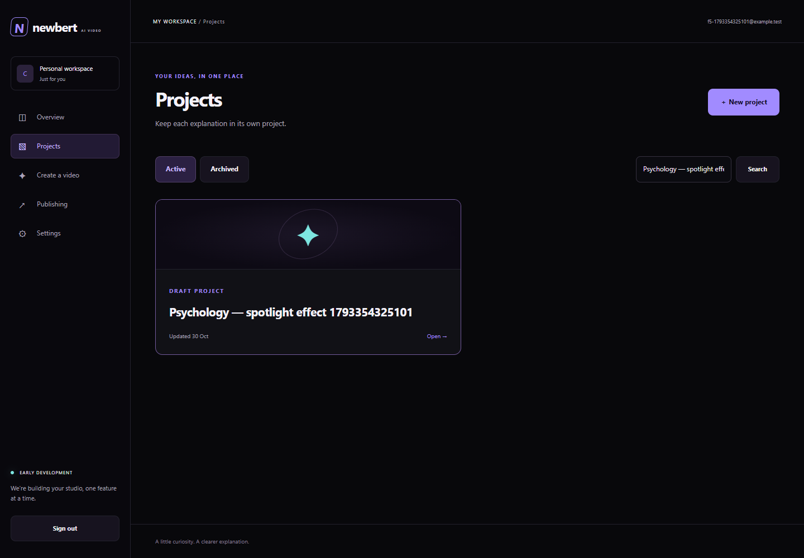
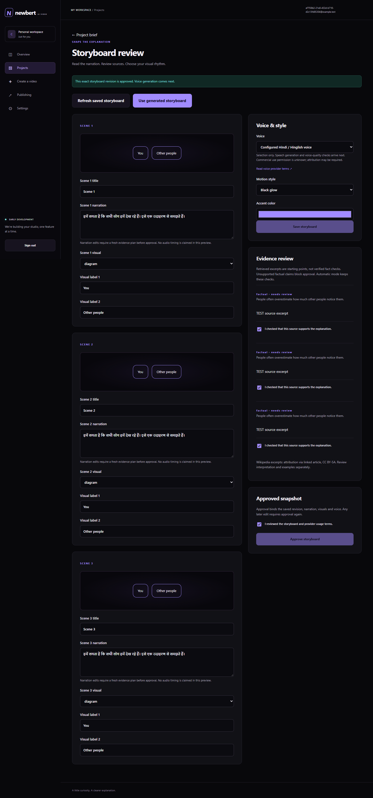
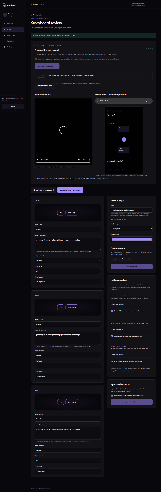
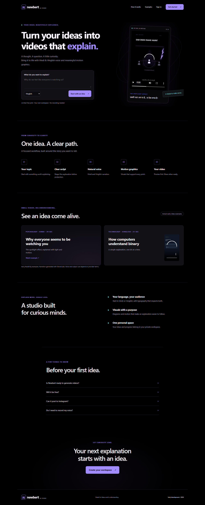
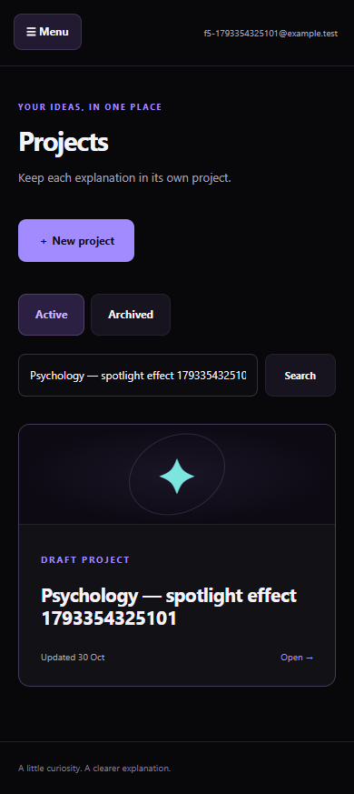
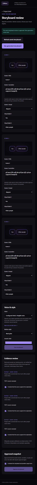

<div align="center">

# Newbert AI Video

**A little curiosity. A clearer explanation.**

Turn a topic into a Hindi or Hinglish educational video—with reviewed scripts, generated narration, and meaningful motion graphics.

[See the studio](#see-the-studio) · [Run locally](#run-locally) · [How it works](#how-it-works) · [Project roadmap](docs/PROJECT-STATUS.md)

**Hindi + Hinglish** · **Private workspaces** · **Narration-driven motion**

</div>



> **Current focus: complete and review the real topic-to-video workflow.** F1–F12, the project/video homepage and highlighted dark/light captions are implemented for local review. Private Supabase storage is connected; hosted database/API/worker deployment is still ahead. Live Instagram setup and publishing are deferred. Follow the [project tracker and remaining checklist](docs/PROJECT-STATUS.md) or read the [simple workflow and hosting guide](docs/SIMPLE-WORKFLOW-AND-HOSTING.md).

## How it works

1. **Start with an idea.** Save your topic, language, audience, and preferred style in a private project.
2. **Explore and plan.** Discuss an angle or queue a source-backed storyboard using Gemini.
3. **Review the explanation.** Edit scenes, inspect source excerpts, choose a voice, and approve the exact saved revision.
4. **Give it a voice.** Generate timestamped ElevenLabs narration after explicit allowance and usage acknowledgement.
5. **Bring it into motion.** Preview an audio-timed composition and play a validated, private MP4.

Source quotations establish provenance, not automatic factual correctness. Unsupported claims block approval, and factual explanations still need human review.

## See the studio

These are screenshots from the local application’s browser checks. Test accounts and deterministic provider responses are used for verification; the video checks use the real local encoder.

| Shape the explanation | Voice, motion, and playback |
| --- | --- |
| [](docs/ui/f7-f8/storyboard-desktop.png) | [](docs/ui/f9-f10/production-desktop.png) |
| Review scenes, narration, visual labels, and evidence. | Generate narration, render motion, and preview private media. |

<details>
<summary><strong>Explore the homepage and mobile views</strong></summary>

### Homepage



### Mobile experience

| Project library | Storyboard review |
| --- | --- |
| [](docs/ui/f5-f6/library-mobile.png) | [](docs/ui/f7-f8/storyboard-mobile.png) |

</details>

## What works today

| Area | Local implementation |
| --- | --- |
| Accounts | Registration, email verification, sign-in, recovery, logout, and one private workspace per account |
| Projects | Creation, title search, archive/restore, structured drafts, revision checks, and immutable submitted versions |
| Planning | Queued idea discussion, bounded Gemini requests, retrieved Wikipedia excerpts, and claim/source references |
| Storyboards | Controlled scenes, Hindi/Hinglish narration, voice/style selection, and exact-revision approval |
| Narration | Free-plan eligibility checks, explicit speech consent, pronunciation mapping, and validated timestamps |
| Rendering | Shared scene operations for browser SVG preview and FFmpeg/libass export; 720 × 1280 H.264/AAC at 24 fps |
| Processing | Durable PostgreSQL jobs, leases, fencing, cancellation, reservations, request caps, and safe narration reuse |
| Media | Private storage, integrity checks, session-bound access links, and authenticated ranged playback |
| Saved videos | Exact-version history, MP4/VTT downloads, playback-link refresh, and conflict-aware draft restoration |

**Next:** personal provider connections, then Instagram authorization and publishing. See the [complete delivery backlog](docs/PROJECT-STATUS.md).

## Run locally

### Requirements

- Node.js **22+** and npm.
- Windows includes a local PostgreSQL launcher; no Docker or system PostgreSQL installation is required for that path.
- FFmpeg is supplied by `ffmpeg-static`. Hindi rendering on Windows requires `C:/Windows/Fonts/Nirmala.ttc`.
- Other environments need compatible PostgreSQL tooling and an installed Devanagari font; see the [database guide](packages/database/README.md) and [rendering requirements](docs/milestones/F9-F10-NARRATION-RENDERING.md).

### 1. Install and start PostgreSQL

```powershell
npm install
npm run db:local
```

Keep that terminal open. If the local database is already running, use it instead of starting another instance on the same port.

### 2. Prepare the database and local logins

In another terminal, from the repository root:

```powershell
npm run db:migrate
npm run auth:setup
npm run worker:setup
```

Setup generates local credentials in ignored files. Confirm these values in `apps/api/.env`:

```dotenv
AUTH_BASE_URL=http://127.0.0.1:3001
APP_ORIGIN=http://127.0.0.1:3001
```

### 3. Start the studio

Run each command in its own terminal:

```powershell
npm run dev:api
npm run dev:worker
npm run dev:web
```

Open **[http://127.0.0.1:3001](http://127.0.0.1:3001)**. The API listens on port **3100**.

For local registration and recovery, email is saved privately on disk. After requesting a link:

```powershell
npm run auth:mail -- your@email.example --open
# Password recovery:
npm run auth:mail -- your@email.example --reset --open
```

This opens the matching local link without printing its token. External inbox delivery requires SMTP configuration.

### 4. Connect generation providers

Configure named server-side settings in `apps/api/.env`; the generation adapters also support their named values in the ignored root `.env`:

```dotenv
GEMINI_API_KEY=
GEMINI_MODEL=gemini-3.1-flash-lite
ELEVENLABS_API_KEY=
ELEVENLABS_VOICE_ID=
ELEVENLABS_MODEL=eleven_multilingual_v2
```

Restart the API and worker after changing configuration. Keep keys out of source control, topics, and narration. Without provider configuration, account/project work still runs and generation pauses safely.

Provider quotas and billing apply. The current speech path checks free-plan eligibility, rejects paid overages, and requires noncommercial-use/attribution acknowledgement. It does not silently switch providers or repeat an uncertain chargeable request.

## Stack and layout

| Layer | Technology / location |
| --- | --- |
| Web | Next.js, React, TypeScript — `apps/web/` |
| API and identity | Fastify, Better Auth — `apps/api/` |
| Worker | Durable polling and stage handlers — `apps/worker/` |
| Data | PostgreSQL, `pg`, ordered SQL migrations — `packages/database/` |
| Shared composition | Controlled scene operations — `packages/contracts/src/composition.ts` |
| Video | FFmpeg/libass, H.264/AAC, measured speech alignment |

## Verification

```powershell
npm run check:f5
npm run check:web
npm run build:api
npm run build:web
npm run test:f9
npm run test:f9:browser
```

The speech/render test suite uses disposable local databases, mocked speech, and the real encoder. The isolated browser suite also uses deterministic provider responses. The latest [F9/F10 review](docs/db/f9-f10-validation-results.json) records **52 automated cases and 10 browser checks** across narration/rendering and related regressions.

Additional suites: `test:f2`, `test:f3`, `test:f4`, `test:f5`, `test:f6`, and `test:f7`. `npm test` covers the earlier feasibility prototype. The opt-in `tests/f9/live-smoke.ts` consumes speech credits and is excluded from routine test commands.

## Current boundaries

- This is a local pilot, with no public deployment or Instagram posting.
- Rendering currently caps narration at 120 seconds and spoken text at 1,600 characters. Daily workspace/global limits also apply.
- The initial research adapter retrieves bounded English/Hindi Wikipedia introductions; it is not an expert fact-checker.
- Caption-only edits support limited punctuation/capitalization corrections. Numeric or wording changes need the narration/evidence approval flow; personal provider connections remain a later milestone.
- Representative listening, educational accuracy, accessibility/device testing, retention/backups, and production operations remain release gates.

## Project documents

- [Status and feature backlog](docs/PROJECT-STATUS.md)
- [Product requirements](docs/PRD-V1.md)
- [Stack decision](docs/decisions/ADR-001-IMPLEMENTATION-STACK.md)
- [Database setup and migrations](packages/database/README.md)
- [Planning and storyboard delivery](docs/milestones/F7-F8-PLANNING-STORYBOARD.md)
- [Narration, rendering, limits, and verification](docs/milestones/F9-F10-NARRATION-RENDERING.md)
- [API contract](docs/api/openapi-v1.json)

<details>
<summary><strong>Earlier feasibility prototype</strong></summary>

The original `server.mjs`, `lib/`, and `public/` implementation remains a separate reference. Its local JSON store and development authentication are not the PostgreSQL/Better Auth studio described above.

```powershell
npm run dev
# Opens the older prototype on http://127.0.0.1:3000
npm run check
npm test
```

Choose **Explore a sample workspace** for an estimated-timing preview without provider keys. Reproducing live samples with `npm run prototype` requires root `.env` configuration and can consume provider allowance. Earlier samples include a roughly 21-second binary explanation and a 39-second spotlight-effect video; these establish feasibility, not broad educational or voice-quality validation.

</details>

Open **Saved videos & history** from a project or storyboard. Run `npm run test:f11` and `npm run test:f11:browser` for isolated verification. [Delivery and caption limits](docs/milestones/F11-OUTPUT-HISTORY-REVISIONS.md).

F12: Settings shows platform voice configuration, current used/reserved/remaining allowances and recent usage. No recording or personal provider key is required. Personal-key connections are deferred. Checks: `npm run test:f12` and `npm run test:f12:browser`. [Delivery record](docs/milestones/F12-USAGE-SETTINGS.md).

F13: Settings/Publishing show Instagram connection status and setup requirements. The local encrypted connection flow is tested with simulated Meta responses; no real account is connected. Run `npm run instagram:setup` and `npm run instagram:check` for safe local preparation. [Operator setup and live acceptance gates](docs/milestones/F13-INSTAGRAM-CONNECTION.md).
