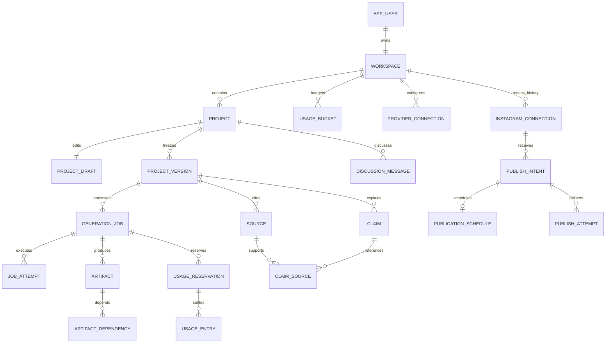

# Newbert AI Video — API and database design V1

Date: 29 October 2026. Status: proposed technical contract, ready for review; no production services or migrations have been deployed.

This follows the reviewed [system design](SYSTEM-DESIGN-V1.md), [PRD](PRD-V1.md), and [video pipeline](VIDEO-PIPELINE-V1.md). It supersedes section 13 of the system design on delivery order: API/database design → design review → UX brainstorming → Google Stitch → implementation. The current application and videos remain feasibility references, not the production API.

## 1. Decisions and deliverables

| Decision | V1 design | Reason |
|---|---|---|
| Database | PostgreSQL; deployment version chosen with hosting | Transactions, ownership constraints, atomic job claims and relational history |
| API | JSON REST, `/api/v1`, OpenAPI 3.1.1 | Explicit contract usable by UI, backend and QA |
| Identity | Established authentication adapter; secure server session | No custom production password/session implementation |
| Ownership | One workspace per identity; one active Instagram destination | Matches confirmed individual-creator product |
| Execution | Database jobs, stage checkpoints, leases and transactional outbox | Durable work without a broker requirement |
| Media | Private object store; metadata and hashes in PostgreSQL | Database holds relationships, not MP4/audio bytes |
| Edits | Editable draft + immutable submitted version + immutable stage artifacts | Existing output and schedules survive later edits |
| Voice credentials | Operator secret or workspace-scoped secret reference | Optional personal ElevenLabs keys without exposing them |
| Initial progress | Polling with recommended poll interval | No WebSocket dependency or invented progress percentages |

Files: [OpenAPI contract](api/openapi-v1.json), [reference PostgreSQL DDL](db/schema-v1.sql), and [review scenarios](API-DB-REVIEW-V1.md). These are design artifacts. DDL is not wired to the prototype; it must become reviewed, ordered migrations during implementation.

## 2. Domain boundaries

The modular backend contains identity/workspaces, ideation, projects/versions, generation, artifacts, usage, provider connections, and publishing. These are code modules, not eight separately deployed services. Authentication login/recovery/logout routes come from the selected identity adapter; the contract below starts after authentication and does not invent an identity vendor API.



## 3. API conventions

The server resolves the workspace from the authenticated identity. Clients cannot choose an owner using a `workspaceId` body field. Any path ID or referenced voice/artifact/connection/version must belong to that workspace. Foreign or missing IDs return the same `404` shape. Operator APIs use separate authorization and are not exposed through creator routes.

Use HTTPS; `HttpOnly`, `Secure`, `SameSite=Lax` session cookie; verify Origin and require a session-bound `X-CSRF-Token` for state-changing requests. `/me` supplies a token to the legitimate UI. OAuth callback is an exception to the CSRF header and uses its own single-use state binding. Authentication and OAuth adapter responses never return credential material. Do not accept wildcard credentialed CORS. API keys travel only over TLS to the server and never return in reads/logs.

IDs are application-generated UUIDs. Times are RFC 3339 timestamps normalized to UTC; display timezone is an IANA name (`Asia/Kolkata`). Store the timezone alongside schedules. Accept explicit-offset timestamps rather than ambiguous wall times. Validate the offset against the supplied timezone for that date; reject nonexistent local times and require an explicit offset for repeated times. Workspace timezone changes never move saved schedules.

Collections use `limit` (default 20, max 100) and an opaque cursor. Order projects by `(updated_at DESC, id DESC)` and immutable histories by `(created_at DESC, id DESC)`. A cursor is signed/bound to workspace, sort and filters; invalid cursors return `400`. Project lists may move during concurrent edits; do not promise snapshot pagination. No unbounded list endpoints.

Mutable resources have a monotonically increasing `revision`. GET emits a strong `ETag`, for example `"draft:UUID:7"`. PATCH and revision-sensitive commands require matching `If-Match`; missing → `428`, stale → `412`. A draft PATCH replaces the submitted fields atomically, increments revision and returns the new ETag. Publishing schedule ETags belong to the intent's revision, updated with schedule changes in one transaction.

All POST commands require `Idempotency-Key` (UUID, max 128 bytes). Scope is `(workspace, method + canonical route including IDs, key)`; hash includes normalized body and relevant preconditions. Same key/body replays the saved status/body/Location even if the old ETag no longer matches. Different body/precondition → `409 IDEMPOTENCY_CONFLICT`. Concurrent callers serialize on this record. Only committed successes are replayed; failed validation rolls back. Keep replay records for at least 7 days and longer while linked work is nonterminal. Expiry does not authorize duplicate publication. Return `Idempotency-Replayed: true` when replayed.

Synchronous create → `201` + Location; accepted background command → `202` + job/intent and Location; GET/PATCH → `200`; disconnect → `204`. Errors use `application/problem+json` with `type,title,status,code,detail,requestId` and optional safe field errors. Do not expose SQL, secret references, raw provider errors or stack traces. Common statuses: `400` malformed, `401` unauthenticated, `403` CSRF/disabled account, `404` inaccessible ID, `409` conflicting active work/state, `412` stale revision, `422` semantic or provider eligibility error, `428` missing precondition, `429` exhausted allowance/rate limit with Retry-After, `503` platform capacity gate. Accepted jobs report downstream failure through job state, not a delayed HTTP error.

## 4. Resources and commands

| Module | Contract routes | Result |
|---|---|---|
| Identity | GET `/me`; GET/PATCH `/workspace` | Identity, workspace, CSRF token, display preferences |
| Catalog | GET `/capabilities`; GET `/voices` | Supported models/components/limits and eligible voices, with provider connection and usage-rights metadata |
| Ideas | GET/POST `/projects/{projectId}/messages` | Saved discussion; POST queues an `ideation` job and returns its ID |
| Projects | GET/POST `/projects`; GET/PATCH `/projects/{projectId}` | Create brief and draft; update display title/archive status |
| Draft | GET/PATCH `/projects/{projectId}/draft`; POST `/projects/{projectId}/draft/apply-result` | Structured edit or explicit import of a completed planning result into a matching draft revision |
| Versions | GET `/projects/{projectId}/versions`; GET `/versions/{versionId}` | Immutable submitted inputs and stage artifact references |
| Generation | POST `/projects/{projectId}/jobs`; GET `/jobs`; GET `/jobs/{jobId}` | `plan` or `produce`, freezes matching draft and queues work |
| Job control | POST `/jobs/{jobId}/cancel`; POST `/jobs/{jobId}/resume`; POST `/jobs/{jobId}/retry` | Cooperative cancel, eligible pause resume, new attempt chain after terminal failure |
| Media | GET `/artifacts/{artifactId}`; POST `/artifacts/{artifactId}/access` | Metadata or short-lived preview/download URL |
| Evidence | GET `/versions/{versionId}/evidence` | Sources, claims, support links and blocking flags |
| Allowance | GET `/usage`; GET `/usage/entries` | Configured limits, used/reserved/remaining values, reset and incurred usage |
| Personal key | GET/POST `/provider-connections`; DELETE `/provider-connections/{connectionId}` | Masked connection metadata; validation queued through outbox |
| Instagram | GET `/instagram/connection`; POST `/instagram/authorization`; GET `/instagram/callback`; DELETE `/instagram/connection` | Official OAuth, connection status and explicit disconnect |
| Publishing | GET/POST `/publish-intents`; GET `/publish-intents/{intentId}` | Immutable authorized payload, exact video or exact automatic production job |
| Delivery control | PATCH `/publish-intents/{intentId}/schedule`; POST `/publish-intents/{intentId}/cancel`; POST `/publish-intents/{intentId}/retry` | Safe reschedule/cancel/retry under state and revision checks |

OpenAPI defines bodies, enums, headers and response fields. No endpoint writes a job state, arbitrary storage path, raw renderer code, remote account ID or encrypted secret directly from the browser. GET of job and intent carries ETag for control commands. Optional diagram/layout/caption corrections are typed draft edits, not a professional timeline editor.

### Guided generation

1. Create a project with topic, `Hindi|Hinglish`, audience, mode, voice and optional target seconds. Instagram connection is not required.
2. Submit `kind: plan` with the draft ETag and idempotency key. Freeze version N and reserve planning resources.
3. Research/script/scene workers save immutable result artifacts and evidence. Successful plan jobs finish; they do not occupy an active job slot waiting for review.
4. Explicitly apply the plan artifact using current draft ETag. A stale draft is never overwritten by worker completion. When freezing a later production version, copy still-valid evidence into that version, allocate new source/claim IDs, remap scene references, and retain provenance to the earlier immutable artifacts. Recheck changed factual claims; approval alone cannot mark an unsupported claim as supported.
5. Creator edits/approves the current draft. Submit `kind: produce, scriptApproved: true` in guided mode. Approval binds to this exact frozen input hash and actor/time. New edits require new approval.
6. Produce speech → alignment → composition → render → validation. Preserve the older ready output until the new output validates.

### Automatic generation

Submit `kind: produce` with draft mode `automatic`. No extra manual approval is introduced. Research, factual preflight and all technical checks still apply. The input version contains the immutable brief; generated storyboard/evidence/scene bundles are immutable, content-hashed artifacts on that version. The brief snapshot is never rewritten with generated text. Every later stage references the exact upstream artifacts it used.

Optional publish-after-generation is a separate explicit POST, referencing this exact job/version and connection. It can be authorized before that job finishes. Bind its pending video once, only to the validated video produced by that job; never to `latestOutput`. User changes create another version/job and cannot inherit the authorization.

### Job response example

```json
{
  "id": "019a0000-0000-4000-8000-000000000001",
  "revision": 3,
  "versionId": "019a0000-0000-4000-8000-000000000002",
  "kind": "produce",
  "state": "running",
  "stage": "generating_voice",
  "queueStatus": "processing",
  "pauseReason": null,
  "error": null,
  "outputArtifactId": null,
  "pollAfterSeconds": 3
}
```

Job state: `queued → running → succeeded|failed|paused|cancelled`. Paused → queued only after the cause is resolved. Cancel sets `cancel_requested_at`; running providers may finish and must be accounted for, but no next stage/publication is allowed. The job becomes cancelled after the worker acknowledges or its lease is safely reconciled. A paused job counts as active. One active job of any kind per project is the initial simplifying rule. Ideation also uses that slot; parallel discussion/generation is a later optimization.

Retry creates a **new** job linked to the terminal failed job and original version, reusing only validated artifacts with matching fingerprints. Paused jobs resume on the same ID. Retry preflight must say whether another provider request is required; if an earlier chargeable request is unresolved, return `409 PROVIDER_OUTCOME_UNKNOWN`. No endpoint can retry an unknown publish outcome as a fresh post.

## 5. Draft, scene and artifact contracts

Draft content schema has `schemaVersion`, `brief`, `voice`, `style`, `scenes`, `pronunciationOverrides`, and `captionOverrides`. Scene fields: stable UUID, learning purpose, component, display narration, spoken narration, display-to-spoken character-span mapping, labels/objects, source/claim UUIDs, and cues referencing a spoken span. V1 components: typography, diagram, flow, timeline, comparison, relationship, chart, steps. Chart values require evidence references or `illustrative: true`.

Display and spoken offsets count Unicode code points, not UTF-16 code units; adapters normalize provider offsets explicitly. Never mix the two. A normalized text hash and explicit mapping preserve Hindi digits, abbreviations and pronunciation corrections. Timing is in integer milliseconds; render frame rate is rational (e.g. 30/1). Alignment/captions must be ordered and within measured audio duration. Round video duration up to a frame, never clip it. Missing alignment blocks success.

Scene documents are validated JSON in the draft/version or storyboard artifact, not a separate editable scenes table in V1. Scenes are read/written as one small, schema-versioned document and require atomic revision control. Evidence uses relational rows because claims link to multiple sources; audio/timed composition/ASS/MP4 and captions are immutable private objects with metadata. This intentionally refines the conceptual Scene entity from system design rather than duplicating it in two stores.

Artifact row: owner, project/version/job, type, private storage key, SHA-256, MIME type, bytes, input fingerprint, validation status, measured duration, renderer/schema/model metadata and timestamps. Speech fingerprint includes normalized spoken text, pronunciation, provider/model, voice/settings and owner. Render fingerprint additionally includes display captions, styles, component/font versions, exact audio/visual dependencies and output profile. Do not cache on narration text alone. Dependencies remain same-workspace; acyclic dependency validation is an application invariant.

Write/upload candidate bytes → verify checksum/properties → register artifact in a short transaction → record dependencies and stage checkpoint. Marking validation pass and advancing the latest-valid-output pointer happen atomically under the job lease and cancellation checks. Artifacts transition only through validation/deletion lifecycle; committed content identity and dependency edges cannot be rewritten. Upload failures leave no ready artifact. Orphans are cleanup candidates after a grace period, not evidence of success.

## 6. Transaction and concurrency rules

### Admit generation

In a short transaction: acquire/replay idempotency key; lock project and draft; authorize; match ETag; check no active job; validate voice/provider/terms/evidence; allocate project version number under project lock; freeze input; atomically reserve all required buckets in deterministic order; insert job and outbox event; persist response and commit. Capacity or quota failure rolls back everything. Use constraint conflicts as a final guard, not a replacement for validation. Return `202` after commit. No provider network calls while holding database locks.

Daily platform and workspace limits use fixed UTC windows for the pilot (clearly displayed with local reset time). Narration milliseconds, render milliseconds, generation count, storage bytes and provider credits are separate integer resources. Actual provider units/cost are not automatically interchangeable with our platform allowance. Limits and cap amounts remain configurable until benchmarks justify them; the prototype's three-per-day default is not a production commitment.

Quota admission: lock all relevant bucket rows in deterministic order and conditionally increment `reserved` only if `used + reserved + requested <= limit`. Reserve platform-funded provider budget as well as workspace allowance. For unknown actual duration, reserve up to the disclosed hard cap, or pause before exceeding a smaller reservation. Never proceed assuming overruns are free. Settlement under bucket+reservation locks decrements the outstanding reservation and increments actual usage once; unique usage event keys prevent double counting. Actual provider overage must still be recorded, even if it puts the bucket over its limit, and closes further admission. Refund platform policy never erases already incurred third-party usage.

All resources consumed by a job are attributed to its admission window even if it finishes after midnight; in-flight reservations survive reset. Publish charges, if any, get their own operation identity. A retry reserves only work not already charged; the successful-video count policy is configurable and independent of stage charges. Storage is a long-lived capacity bucket (not a daily reset): its database end can be infinity and its API `resetsAt` is null. Reconciliation entries, not editing history, explain corrections.

### Claim and checkpoint work

Choose an eligible workspace using its durable dispatch cursor and active count; lock its dispatch row, then claim its oldest eligible job using `FOR UPDATE SKIP LOCKED`. Enforce workspace/global pool concurrency before claim. SKIP LOCKED alone is not a fairness policy. Commit lease owner, expiry and incremented fencing token before work; heartbeat extends only the current token. Every checkpoint uses `WHERE lease_token = expected AND state = 'running'` and checks cancel status. Late workers cannot commit after losing their lease. Release transaction before rendering or provider calls.

Job attempts record logical stage, attempt number, hashed request fingerprint, provider request identity, `prepared|submitted|succeeded|failed|unknown` state, and artifact identity. Record prepared request before transmission. A process crash between external acceptance and receipt recording becomes unknown; an expired lease does not make repeating a chargeable call safe. Retry safe computation automatically with bounded backoff; reconcile or pause uncertain speech calls. Save provider error codes through a sanitized mapping.

Outbox delivery is at-least-once. Unique event keys and consumer checks make repeated dispatch safe. The durable job scan recovers queued work even if a notification is lost. Do not mark an outbox record delivered before its side effect is durably accepted. Dispatcher/cleanup/worker roles are privileged internal capabilities, never browser credentials.

### Schedule and publish

Publish intent fixes actor/time, input payload hash, destination connection ID, connection generation, caption, source exact video or producing job, late policy and permitted retries. A connection generation identifies one OAuth grant; reconnect produces a new connection ID. Existing intents pause and require explicit reauthorization through a new intent, even for the same remote account. Never silently substitute a destination.

Schedule is a separately versioned UTC time attached to the same intent. Rescheduling uses intent ETag and locks the intent and schedule; it is allowed only before worker dispatch. Immediate/publish-when-ready uses no schedule row. Timed work has explicit `lateToleranceSeconds`; after its deadline set `paused`/attention, not automatic late publication. Timing changes do not change video identity.

Due-worker claim rechecks connection, authorization, validation, retention, late window and cancel flag in one short transaction. Provider container/media IDs and every publication request are saved in publish attempts. Response lost after remote submission → `reconciliation_required`; no fresh submission until remote state is resolved. If success is established, complete the old intent. If nonpublication is confirmed, a recorded retry may resume the same frozen intent. No cross-system exactly-once guarantee is claimed.

Cancel before dispatch wins under the same intent lock. Cancel while submitting sets cancel_requested and waits for remote outcome: a post already published is recorded as published, never falsely cancelled. Cancelling a generation job cancels a dependent waiting intent only before remote submission; subsequent publish reconciliation still runs. Disconnect pauses pending intents and revokes secret access after outstanding submissions are reconciled or explicitly escalated.

## 7. Database integrity and access

The reference DDL uses composite foreign keys `(workspace_id, ...)` throughout owned relationships, uniqueness for one workspace/user and one active Instagram connection, a partial unique index for active jobs, nonnegative units, unique version numbers and operation keys. A version, artifact or publication source from another project cannot be attached using just a guessed UUID. READY video linkage is additionally checked at the service transaction boundary; SQL foreign keys alone do not prove codec, evidence or license eligibility.

The `latest_output_artifact_id` points to a validated video on that project, never whatever the most recent job happened to write. `publish_intents` stores either a fixed video, or a produce job plus a once-only bound output. Schedules cannot reference a mutable draft. Historical connection rows remain because old intents need their exact destination identity.

RLS is defense in depth for all workspace tables. Application-role transactions set `app.workspace_id` from trusted session resolution with `SET LOCAL`; never from request JSON. Workspace membership is resolved by a narrowly scoped identity bootstrap path before tenant queries. Web DB role must not be owner/superuser/BYPASSRLS. DDL uses FORCE ROW LEVEL SECURITY; internal dispatcher/worker roles have separately reviewed rights and server-side ownership validation. A session variable is not a boundary against arbitrary SQL execution or compromise of the backend. Pool transactions must reset context; missing context returns no tenant rows.

`app_users` holds identity mapping, not passwords or session cookies. Sessions/recovery remain owned by the selected auth adapter. `secret_ref` is a vault/envelope-encryption identifier, never the API key/token. Operator keys remain outside tenant tables. Key creation validates format, stores secret through a secret-store adapter, commits connection metadata/outbox, and cleans up an orphan secret if the DB commit fails. Metadata state begins `pending_validation`; validation failure returns an actionable status without returning provider responses or secrets.

Immutable version rows reject UPDATE/DELETE in the reference DDL. Production grants must also deny ordinary edits of committed artifact payloads, evidence, usage ledger, attempt request identities and authorization snapshots. State transitions use narrow service functions/allowlisted writes, not general resource PATCH. Account deletion uses a separate privileged, audited retention workflow; it must not be implemented by letting a creator cascade-delete history while publishing may be in flight.

## 8. Retention and operations

Archive is reversible project metadata; it does not delete media or cancel scheduled work silently. V1 account deletion is an asynchronous privileged workflow: disable admission → cancel/resolve jobs and deliveries → revoke secrets → delete eligible objects → pseudonymize permitted audit/accounting history → remove identity. Retention periods, legal obligations and backup recovery objectives must be decided before pilot release; no indefinite retention promise is made here.

Artifact cleanup locks metadata and verifies no active job, validated output, dependency chain, pending/uncertain intent or retention hold references the object. Mark deleting first, delete object idempotently, then mark deleted; crash recovery repeats deletion safely. Removing a file path from a project is insufficient. Short-lived access URLs expire independently; use an explicitly scoped access window for official Instagram ingestion and do not log signed URLs.

Audit records hold actor/action/target/request IDs and redacted metadata. Provider secrets, OAuth codes, signed URLs and full scripts are excluded. Track queue wait/stage time, job retries/pauses, reservation age, unknown outcomes, reconciliation backlog, media integrity and provider spend. Alert on old leases/outbox records and reservations stranded by terminal jobs.

## 9. What is enforced where

| Invariant | Database | Service/worker |
|---|---|---|
| One workspace/user, active Instagram/job uniqueness | Unique/partial indexes | Friendly conflict response |
| Same workspace/project references | Composite foreign keys and RLS | Authorize each lookup before insert |
| Version inputs immutable | UPDATE/DELETE trigger | Hash canonical document, schema validation |
| No lost updates | Revision columns | Conditional UPDATE/If-Match |
| No duplicate platform settlement | Unique usage event key | Atomic bucket/reservation/entry transaction |
| No stale worker completion | Lease token column | Conditional checkpoint on token and cancel state |
| Valid claims/timing/MP4 | Stored validation metadata | Validators plus human evaluation set |
| No accidental duplicate publication | Intent/attempt identity, locks | Reconcile uncertain remote result before retry |
| No stale schedule repoint | Frozen FK and authorization fields | Reschedule only time, never source/destination |

The SQL is intentionally a reference schema, not a claim that all business rules are declarative constraints. [Review scenarios](API-DB-REVIEW-V1.md) separate executable checks from implementation acceptance cases.

## 10. Remaining choices before implementation

Choose auth adapter, cloud/runtime and secret store, database deployment/version, research adapter, final renderer and font packaging, quantitative allowances/retention, and official Meta login/scopes/access path. Provider URLs/scopes are not asserted by our internal publishing contract; verify those against official Meta documentation in its integration milestone. No new API key or cloud purchase is required to review this design.

Next: review the API/database flows and resolve material changes, then brainstorm screens and states using these contracts, then use Google Stitch. Do not connect this schema to the prototype or start UI implementation as part of this design task.

References: [OpenAPI 3.1.1](https://spec.openapis.org/oas/v3.1.1.html); PostgreSQL [row security](https://www.postgresql.org/docs/17/ddl-rowsecurity.html) and [queue locking](https://www.postgresql.org/docs/18/sql-select.html). RLS does not replace authorization; referential integrity checks bypass row security. SKIP LOCKED is suitable for queue consumers, not a general consistent read strategy.
