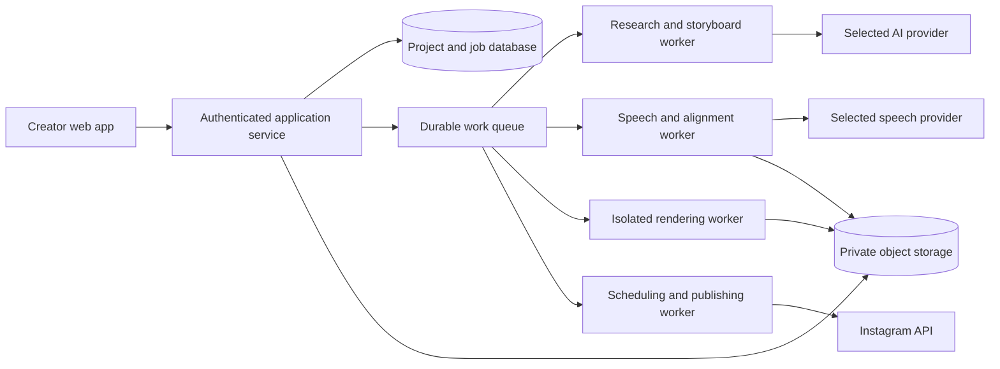

# Newbert — Architecture and first implementation

Historical implementation note. The current proposed architecture is [V1 System Design](SYSTEM-DESIGN-V1.md). Existing prototype choices do not constitute architecture approval. Further implementation is on hold while the design is discussed.

Date: 28 October 2026
Status: working local foundation; target cloud architecture remains subject to pipeline benchmarks.

## Target responsibilities

The API saves input and queues work instead of holding an HTTP connection open. Workers operate on pinned versions, save artifacts between stages, and do not depend on the creator's browser. Publishing consumes validated output and a recorded authorization; it does not regenerate content.

## Implemented local mapping

| Responsibility | Current module | Limitation |
| --- | --- | --- |
| UI | public/app.js and styles.css | Lightweight browser modules rather than a framework |
| API and session ownership | server.mjs | Local development authentication; no recovery/verification |
| Persisted records | lib/store.mjs | Atomic file replacement; one process only |
| Validation and alignment | lib/domain.mjs | Provider alignment required; fallback pending |
| AI adapters | lib/providers.mjs | Keys required; no source retrieval |
| Background orchestration | lib/jobs.mjs | One worker, durable job records, no distributed leases |
| Shared visual primitives | public/scene.js | Initial typography, cards, and comparisons |
| Audio/video processing | lib/render.mjs | FFmpeg/ASS feasibility renderer; typography parity requires review |
| Media | .data/media | Local private files rather than object storage |
| Instagram | Not yet implemented | UI does not claim a working connection |

This deliberately small first implementation validates the processing contracts without coupling them to a cloud vendor. The suggested Next.js/Gemini/ElevenLabs/Remotion/MongoDB/R2/Inngest stack remains a candidate; this prototype does not silently approve it or claim equivalent production readiness.

## Key data relationships

User → one implicit workspace → projects → revisions and generated artifacts.

Jobs carry owner, project, input revision, stage, state, and provider voice reference. Authentication sessions store a hash of the browser token. Passwords use salted scrypt. Generated files use project and job identifiers; every media request checks the signed-in owner.

During an active job the first implementation locks project edits instead of implementing a parallel draft branch. Stale save revisions return a conflict. Ready output stays available if later generation fails. Artifact directories use unique job IDs so later attempts do not overwrite earlier files.

## Before external deployment

1. Benchmark real Hindi/Hinglish speech and representative motion graphic output.
2. Select managed authentication and database; migrate local records and ownership rules.
3. Introduce a durable queue with leases, per-workspace fairness, bounded retries, duration-based reservations, and global spending controls.
4. Move media to private object storage with signed access and retention/deletion rules.
5. Resolve rendering choice from benchmark evidence, including Hindi font shaping, timing, layout, runtime, and cost.
6. Add retrieval and claim evidence, alignment fallback, and automatic-mode authorization.
7. Implement official Instagram authorization and publishing with pinned destinations, schedules, idempotent intents, and uncertain-outcome reconciliation.
8. Run the PRD's full evaluation and release checklist before calling the product V1 complete.
