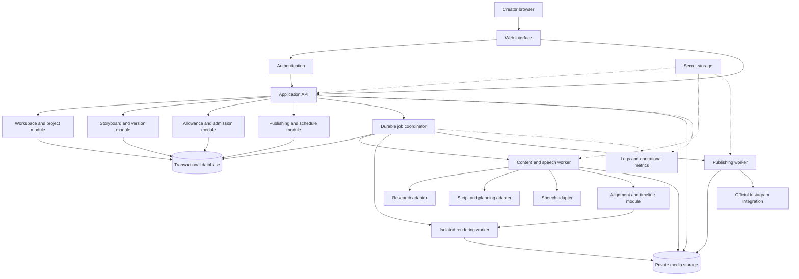

# Newbert AI Video — V1 System Design Architecture

Date: 28 October 2026
Status: Proposed design for discussion and finalization. This document authorizes no deployment or implementation.
Basis: V1 PRD revision 1.1 and the agreed video processing pipeline.

## 1. Purpose and decisions

This architecture defines the complete intended V1 system independently of the premature local prototype. Existing prototype technology is not a constraint or an approved architecture decision.

Confirmed product requirements: many registered users; one private workspace per user; at most one Instagram connection per workspace; Hindi/Hinglish generated narration; educational motion graphics; narration-driven duration; guided and automatic production; daily limits and waiting queues.

Recommended architecture: one modular application backend, a transactional database, private media storage, and a separately runnable background worker. Modules remain in one codebase initially. A worker is a background process, not a separate microservice for every pipeline stage. Rendering must run outside web requests so it cannot block the dashboard or depend on an open browser.

Recommended design choices are proposals until reviewed. Azure services, paid plans, machine sizes, exact quotas, and final provider models are deliberately not selected here.

## 2. Logical system view



Arrows show dependencies and responsibilities, not separate servers. The API controls authorization; the database is authoritative for state; media storage holds bytes; workers execute work.

## 3. Component responsibilities

| Component | Owns | Must not do |
| --- | --- | --- |
| Web interface | Idea discussion, storyboard, progress, preview, publishing choices | Hold provider secrets or execute required cloud rendering |
| Authentication | Identity, sessions, recovery, session revocation | Treat an Instagram login as permission to access another workspace |
| Application API | Ownership checks, validation, saved drafts, generation commands | Wait through an entire rendering job in an HTTP request |
| Job coordinator | Stage dependencies, leases, retries, cancellation, resume | Assume queue delivery happens exactly once |
| Content worker | Research, structured scripts, speech provider calls | Invent evidence or run model-generated code |
| Timeline module | Map actual speech to scenes, visual cues, caption phrases | Fabricate timing when alignment fails |
| Rendering worker | Validated scene components, fonts, audio, composition, encoding | Access arbitrary external URLs, user scripts, or cloud secrets |
| Media storage | Private audio, captions, assets, exports, checksums | Use public buckets as the normal access method |
| Publishing worker | Scheduled delivery, processing checks, remote-result reconciliation | Blindly retry an uncertain publish request |
| Operations | Health, queue pressure, errors, quota/spend circuit breakers | Expose every creator's project to other creators |

## 4. Database recommendation and model

Recommend PostgreSQL or an equivalent transactional relational database for V1. Projects, versions, usage reservations, schedules, and worker claims have linked consistency rules. Structured scene content can live in JSON fields without putting binary media in database rows. MongoDB remains an alternative if equivalent transaction, indexing, and atomic-claim behavior is demonstrated; the prior reference did not settle this choice.

| Entity | Key fields and relationships |
| --- | --- |
| User | Identity-provider subject, account status, timezone |
| Workspace | Unique user ID; one workspace per user |
| Project | Workspace ID, topic, language, audience, current draft, latest valid output |
| ProjectVersion | Project ID, version number, immutable generation snapshot, schema version, input hash |
| Source / Claim | Version ID, URL/title/retrieval time, supporting excerpt or reference, claim links |
| Scene | Stable ID, version ID, narration spans, supported component, visual objects, event cues |
| Artifact | Workspace/version/job IDs, type, private storage key, checksum, duration, validation, dependencies |
| Job / JobAttempt | Version ID, state, stage, lease owner/expiry, retry count, provider request ID, operation key |
| UsageReservation / UsageEntry | Workspace, resource, reservation, actual usage, reconciled/released status |
| ProviderConnection | Workspace or operator scope, provider, encrypted-secret reference, usable status |
| InstagramConnection | Unique remote account ID, workspace, permissions, encrypted-token reference, status |
| PublishIntent | Exact asset version, caption, destination, authorization, remote container/media IDs, outcome |
| Schedule | Intent ID, local timezone, UTC execution time, late-delivery policy, cancellation state |
| OutboxEvent | Event type, referenced record, delivery state, attempt count |

Required constraints: unique workspace/user; unique active Instagram destination; unique project/version number; unique operation keys; one active production pipeline/project. Index project lists by workspace, runnable jobs by state and eligibility, and schedules by due time/state. Every owned query includes workspace authorization. Object path prefixes are not authorization checks.

## 5. Requests and asynchronous execution

Proposed command contract:

1. Browser submits a validated command with an operation key and expected draft revision.
2. API checks session, ownership, supported inputs, limits, and active-job conflicts.
3. In one transaction, freeze the input version, reserve usage, create a job, and write its outbox event.
4. Return a durable job ID. The browser polls progress initially; streaming updates can follow later.
5. A dispatcher delivers the event. Re-delivery is safe because the job has a unique operation key.
6. A worker atomically claims a stage with an expiring lease and heartbeat.
7. It writes temporary output, validates it, uploads it privately, then records the durable artifact and next stage.
8. Only after durable commit does the stage become successful. Orphaned uploads are cleaned up later.

A database-backed job table and periodic dispatcher are sufficient starting proposals. Do not add both a separate message broker and a hosted orchestration product by default. If later capacity needs a broker, keep the database authoritative and retain the outbox. This avoids the failure where a saved project exists but its job was never queued.

## 6. Generation sequence

```mermaid
sequenceDiagram
    participant U as Creator
    participant A as API
    participant D as Database
    participant W as Worker
    participant P as AI and speech providers
    participant M as Private media storage
    U->>A: Generate from a specific input version
    A->>D: Save job, input snapshot, reservation and outbox
    A-->>U: Job ID
    W->>D: Claim job stage
    W->>P: Research and structured storyboard requests
    W->>D: Save evidence and storyboard
    Note over U,W: Guided review may pause here; automatic mode continues after checks
    W->>P: Generate selected narration
    P-->>W: Audio and available timing
    W->>M: Persist narration
    W->>D: Save speech artifact and provider request identity
    W->>W: Measure, align, compose and render
    W->>M: Save validated video
    W->>D: Mark exact output version Ready and settle usage
    U->>A: Read job and preview result
    A-->>U: Authorized private media access
```

Visual asset preparation can overlap narration after inputs are frozen. Final animation timing waits for actual audio. A request for publication is a separate recorded command, including when the user configures publish-after-generation in advance.

## 7. Scene and timing contract

A scene definition contains schema version, stable scene/object IDs, learning purpose, narration text, pronunciation overrides, supported visual component, labelled objects/layout parameters, source/claim references, and animation events attached to narration spans. After speech, add measured scene boundaries and caption timing.

Recommended rendering direction: controlled React/Remotion compositions plus media encoding/inspection tools, subject to licensing and render benchmarks. AI proposes structured content; application-owned components implement animation. No arbitrary AI-generated JavaScript is executed. Preview and export consume the same composition and font definitions. The existing FFmpeg feasibility renderer does not determine the final renderer.

Validate alignment against spoken forms with explicit mappings to display captions. Provider timestamps are preferred when valid; a forced-alignment adapter is the fallback. Choose its implementation only after Hindi/Hinglish evaluation. Missing alignment blocks Ready. One continuous speech track per version is the initial default; chunking is an explicit provider-limit accommodation.

Narration defines duration. A configurable cap bounds pilot resources. Visual holds and frame rounding may accommodate audio; silently truncating or accelerating it is disallowed. Save renderer/component versions and generated assets rather than assuming generative output can be reproduced exactly.

## 8. Versioning and revision dependencies

Drafts are editable with optimistic concurrency. Submitted input snapshots, validated artifacts, and publication payloads are immutable. A new draft may coexist with an older running or scheduled version.

| Edit | Invalidate | Retain if input fingerprints match |
| --- | --- | --- |
| Diagram/layout/label size | Composition, render, validation | Narration and alignment |
| Caption display spelling | Caption layout, render, validation | Narration and alignment mapping |
| Narration wording/pronunciation/voice | Speech, alignment, timed composition, render | Valid evidence and compatible visual intent |
| Topic or explanation meaning | Affected research and every dependent result | Only explicitly unchanged dependencies |
| Post caption or delivery time | Publish payload/schedule revision | Exact validated video |

Cache reuse is scoped to the owner and includes text, voice, model, pronunciation, settings, and schema versions. Audio is not reused across users by default. Replacing a scheduled video requires explicit new authorization; edits cannot silently repoint a schedule.

## 9. Scheduling and publication

The creator connects one eligible Instagram account through official authorization. The operator configures developer-app credentials and callbacks separately from creator authorization. Callback state binds to the initiating session. Tokens remain encrypted server-side.

The publishing module freezes destination, caption, asset version, and authorization in a publish intent. Schedules store UTC and the original timezone. A durable due-job scan claims delivery atomically, checks access and asset availability, submits media, checks processing, requests publication, and confirms remote outcome.

Outcomes are confirmed success, confirmed failure, or unknown. Save remote identifiers as soon as available. Timeouts after submission enter reconciliation; do not interpret a successful upload as a successful post. New submission is prohibited until a previous uncertain outcome is resolved or an explicit safe decision is recorded. No claim of exactly-once external publication is made.

Account replacement/disconnection pauses pending deliveries. Cancellation races use atomic state transitions; already-submitted work still needs reconciliation. Proposed missed-schedule behavior remains the PRD's bounded retry window followed by attention, unless publish-when-ready was explicitly chosen. Platform eligibility, scopes, media rules, and app approval are integration verification tasks, not assumed solved here.

## 10. Reliability and capacity controls

- Internal delivery is at-least-once; unique keys, atomic state transitions, and artifacts make repeated execution safe where possible.
- Expired leases recover abandoned stages. Final output is not replaced until the replacement validates.
- Transient read/compute failures use bounded retries and backoff. Invalid input or authorization pauses instead of looping.
- A speech timeout may have incurred a charge. Reconcile supported provider request status first; where impossible, pause before another chargeable request.
- Cancel prevents later work; already-running provider requests may complete. Actual incurred usage is recorded.
- Fair scheduling rotates eligible workspaces. Limit active jobs per workspace and rendering concurrency globally.
- Reserve estimated narration/render usage before work; enforce measured duration and reconcile actual usage. Never double-debit our ledger for an internal retry.
- Enforce daily platform limits and a spending circuit breaker as well as per-user limits. No silent paid overages or silent voice/provider substitution.
- Database and object storage cannot share one transaction. Use upload-then-commit with checksum validation and orphan cleanup.
- Cleanup cannot delete assets referenced by jobs, schedules, or unresolved publish attempts.

## 11. Security, storage, and operations

Use managed identity/session facilities or a well-supported authentication library; the local prototype's login is not the deployment design. Keep ownership enforcement in API and worker boundaries. Workers derive ownership from stored records, not event-provided owner IDs.

Use private object storage for audio, video, captions, and render assets. Issue short-lived preview/download links; Instagram ingestion needs an access window long enough for its processing. Avoid proxying every video byte through the web application.

Operator keys belong in secret storage. Optional personal voice-provider keys belong in encrypted owner-scoped records, never plaintext browser storage. Restrict render-worker file/network access and accept only controlled assets; validate remote asset fetching against SSRF and resource limits.

Log stage latency, queue wait, retries, provider usage, render memory, validation failure, and publishing outcomes using correlation IDs. Redact secrets and raw user content by default. Monitor unknown publish outcomes and jobs with expired leases. Define basic infrastructure backup, restore ownership, and retention before deployment; a custom backup product is not required. Recovery objectives remain uncommitted until infrastructure selection.

## 12. External services and credentials — discussion list

No credentials are needed to review or finalize this design. Do not send API keys in chat.

| Capability | Proposed option | What would be needed later |
| --- | --- | --- |
| Script and scene planning | Google Gemini candidate | Server API key, selected supported model, usage/data-use review |
| Evidence retrieval | Search/retrieval adapter, vendor undecided | Source policy, supported retrieval service, any required credentials |
| Narration | ElevenLabs candidate; low-cost alternative to evaluate | API key, permitted stock voice, plan/output-use rights, Hindi/Hinglish test |
| Alignment | Valid speech-provider timing, with tested fallback | Hindi/Hinglish evaluation and resource measurement |
| Motion graphics | Application-owned components; Remotion candidate | Renderer dependency/license evaluation; no generative-video API required by default |
| Database and storage | Transactional database and private object store | Hosting choice, identities, connection configuration |
| Authentication | Supported auth implementation | Session/recovery configuration and email or identity connection |
| Instagram | Official Meta integration | Developer app, callback setup, permissions/access review and per-user connection |
| Deployment | Azure evaluation after architecture review | Service mapping, budget, region, permissions and measured workload |

Gemini's documentation describes structured JSON output. ElevenLabs documents speech responses containing character timing. These capabilities fit the proposed adapters; neither guarantees educational accuracy or Hinglish voice quality. See the official references below.

## 13. Azure and implementation sequence

Agreed order following the user's correction:

1. Review and finalize this logical architecture and its data/state contracts.
2. Evaluate deployment mapping, including Azure, with current costs and limits. Select a budget before provisioning.
3. Discuss provider accounts, API needs, permitted usage, and voice choices.
4. Build the narrow processing prototype against the agreed interfaces.
5. Use prototype measurements to finalize machine sizing, concurrency, duration caps, and daily allowances.
6. Implement the wider V1 and verify its release criteria.

Finalizing logical architecture does not require pretending runtime measurements already exist. It fixes ownership and interfaces while leaving numeric capacity tunable. No Azure resource, subscription, provider purchase, or API call on the user's account is created by this document.

## 14. Architecture review decisions

Recommended defaults for discussion: modular backend with separately runnable workers; transactional relational database; private object storage; database-backed jobs/outbox initially; structured reusable motion graphics; replaceable provider adapters; narration as master clock; separate publishing state machine.

Items still requiring an explicit choice or evidence: database engine acceptance, authentication implementation, final renderer, research provider, speech plan/voice, cloud mapping, and numerical cost/capacity limits. Keep these as a decision register; do not treat existing prototype code as approval.

## 15. Official references checked during design

- [Gemini structured output](https://ai.google.dev/gemini-api/docs/structured-output)
- [ElevenLabs speech with timing](https://elevenlabs.io/docs/api-reference/text-to-speech/convert-with-timestamps)
- [Remotion renderer](https://www.remotion.dev/docs/renderer)

This design makes no commitment to vendor free-tier quotas or current prices. Those belong in the later provider and Azure evaluation.
