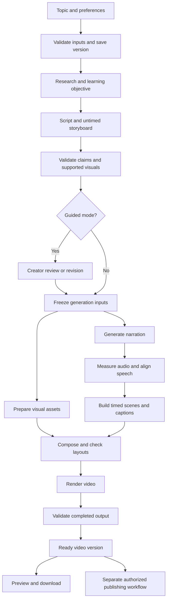
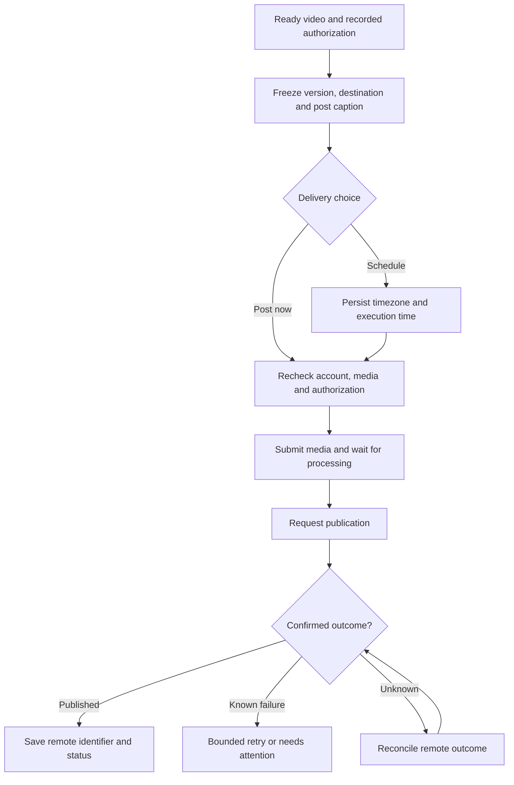

# Newbert AI Video — V1 Video Processing Pipeline

Status: Proposed processing design derived from PRD revision 1.1.
Date: 28 October 2026
Scope: how content moves from topic to output and publication. Provider selection, deployment architecture, and implementation are separate next steps.

## 1. Core decisions

- Plan the explanation and visual intent together before generating narration.
- Finalize scene duration and animation timing only after actual narration exists.
- Build motion graphics from controlled reusable components and structured scene data.
- Preserve completed artifacts so revisions and failures do not restart everything.
- Keep generation and publishing as separate workflows.
- Use the same processing pipeline for guided and automatic modes; only the review checkpoints differ.

## 2. Main flow



Failures do not imply moving forward: transient faults retry the affected stage; unresolved input, evidence, timing, or authorization problems pause or fail it. There is no path from a failed output check to publishing.

## 3. Stage responsibilities

| Stage | Work | Saved output | Exit condition |
| --- | --- | --- | --- |
| 1. Intake | Accept topic, Hindi/Hinglish, audience level, voice, optional approximate length, mode | Versioned creative brief | Required inputs valid; owner and capacity checks pass |
| 2. Research | Find relevant evidence and define what the viewer should understand | Learning objective, sources, claim references | Material claims supported or clearly marked for review |
| 3. Storyboard | Write narration and assign meaningful visual components to explanation segments | Script and untimed scene plan | Complete explanation; supported visual vocabulary |
| 4. Preflight | Validate schema, claims, text limits, asset requirements, voice availability, and estimated resource allowance | Validated immutable generation input | Blocking issues resolved; guided approval recorded when applicable |
| 5. Narration | Convert script to speech using selected voice and pronunciation instructions | Audio, provider details, raw timing if supplied | Usable audio; no obvious missing ending or accidental duplication |
| 6. Alignment | Measure audio and map spoken words/phrases to narration spans | Measured duration and validated alignment | Ordered timestamps within audio bounds; acceptable coverage |
| 7. Timeline | Map scene boundaries, animation cues, and caption phrases onto actual audio | Timed composition and caption track | Full audio covered; supported duration cap respected |
| 8. Composition | Resolve layouts, fonts, assets, caption safe areas, and visual events | Render-ready composition | No missing dependencies, invalid timings, or known text collisions |
| 9. Rendering | Produce MP4 from validated composition and narration | Candidate MP4 and render metadata | File successfully written and stored durably |
| 10. Output checks | Check playback, dimensions, audio, duration, captions, and file integrity | Validation report and Ready artifact | Required checks pass |
| 11. Delivery | Expose the exact video version for preview/download; hand off authorized posting intent | Download reference and optional publish intent | Output identity preserved |

Visual asset preparation may run alongside narration after inputs are frozen. It must not finalize scene timing before alignment. In V1, controlled icons, shapes, fonts, diagrams, and chart data are sufficient; generative image/video services are not mandatory stages.

## 4. Example: confirmation bias in Hinglish

Input: explain confirmation bias to college students using a relatable example.

The storyboard might contain:

| Scene | Narration purpose | Visual intent |
| --- | --- | --- |
| Hook | Ask why two people interpret the same evidence differently | Two opinions facing the same evidence |
| Definition | Explain the tendency to favour supporting information | Evidence cards moving through a selective filter |
| Example | Show someone focusing on favourable product reviews | Supporting reviews highlighted; contrary reviews overlooked |
| Takeaway | Suggest deliberately examining opposing evidence | Both sets of evidence brought into view |

Before speech, these scenes have narration spans and estimated duration. Suppose the generated audio measures 73.4 seconds. Alignment then establishes the actual scene boundaries. The final picture covers those 73.4 seconds, rounded up only to the next output frame. No unrelated animation is added to reach 90 seconds, and narration is not cut to reach 60 seconds.

This is an illustrative storyboard, not researched final narration or a generated asset.

## 5. Timing contract

The narration audio is the master clock. Visual events reference stable narration spans, then resolve to timestamps after alignment. Scene boundaries follow semantic explanation changes rather than equal-duration slices.

- Use provider timing only after validation; otherwise use a tested forced-alignment method that maps known text to the actual audio.
- Keep display text and pronunciation text separate, with an explicit mapping between them.
- Validate normalized text coverage, monotonicity, bounds, pauses, and the final spoken segment.
- Group words into readable caption phrases with at most two lines.
- Derive animation cues from aligned words/phrases; mark intentional visual leads explicitly.
- Convert seconds to output frames consistently. Video may outlast audio by less than one frame due to rounding; it must never clip audio.
- If timing cannot be recovered, do not claim the video is synchronized.
- If measured duration exceeds the pilot cap, pause for shortening rather than silently truncating or accelerating speech.

Start with one continuous narration track per version to reduce joins and voice inconsistency. If provider text limits require chunking, use sentence boundaries, consistent settings, measured joins, and saved chunks. An edit may require regenerating the full track in V1; segment-level audio reuse is an optimization, not a quality guarantee.

## 6. Artifacts and version identity

Every saved stage result carries workspace, project, input-version, stage, input fingerprint, and artifact identifiers. Provider/model settings accompany generated artifacts. Media remains private.

Logical artifact chain:

```text
Creative brief
  → Evidence notes
  → Script + untimed storyboard
  → Narration audio + alignment
  → Timed composition + captions + asset references
  → Rendered video + validation report
  → Ready version
  → Optional authorized publish payload
```

Stable scene IDs and object IDs keep revisions attached correctly after reordering. The latest draft and latest valid video are different references. Neither automatically replaces an approved scheduled version.

## 7. Guided and automatic behavior

| Checkpoint | Guided | Automatic |
| --- | --- | --- |
| Idea discussion | Available | Optional; topic can proceed directly |
| Script/storyboard review | Creator can review and approve | System validates without mandatory manual review |
| Output checks | Always required | Always required |
| Final preview | Available before publishing choice | Available; no mandatory stop for an already authorized automatic run |
| Publishing | Post now or Schedule authorizes exact output | Requires recorded publish-after-generation instruction for exact inputs, destination, and policy |

Starting generation alone does not authorize publishing. Material revisions create a new version and do not inherit publishing permission silently.

## 8. Revisions and minimum reprocessing

| Change | Reuse when valid | Re-run |
| --- | --- | --- |
| Label size, colour, or layout | Evidence, narration, alignment, caption timing | Composition, render, output checks |
| Caption spelling/display | Narration and alignment | Caption layout, render, output checks |
| Spoken words or pronunciation | Unaffected evidence and visual intent | Speech as needed, alignment, timeline, composition, render, output checks |
| Topic or explanation meaning | Only explicitly unchanged dependencies | Research/script validation and dependent stages |
| Instagram caption or schedule time | Validated video | Publish-payload validation and scheduling |

A caption edit changing meaning is a spoken-content revision, not a display correction. All revisions preserve the last successful artifact. Recovery from missing media produces a new reviewable version rather than silently replacing a scheduled video.

## 9. Queue, retry, and cancellation rules

- Save a job and return its identifier; do not hold the browser request open through rendering.
- One active production job per project; deduplicate repeated Generate clicks.
- Reserve estimated usage before chargeable work, then reconcile measured usage. Recheck capacity before expensive stages.
- Persist successful stages before starting dependent work.
- Retry transient failures with bounded backoff. Pause invalid credentials, insufficient quota, and unsupported inputs with a useful next action.
- On an ambiguous speech-provider timeout, check request status or provider idempotency where available before submitting again. If neither is available, expose potential repeated provider charges and pause for a user decision; never claim retries guarantee no provider charge.
- Stage-level retry does not double-charge Newbert's own allowance reservation.
- Cancel prevents later stages and publishing; already-started provider work may finish. Record actual usage separately from cancellation state.
- Fair queueing and global limits protect capacity across workspaces. Jobs survive browser closure and recover expired worker ownership.

## 10. Separate publishing pipeline



Reconciliation is bounded per attempt and may remain unresolved; it is not a tight retry loop. Never blindly issue a second publish request after an unknown outcome. Scheduling does not regenerate a video. Disconnecting or changing accounts pauses affected deliveries without redirecting them. Generation can succeed while publishing fails, and download remains available.

## 11. Architecture review, then prototype validation

Updated sequence: finalize logical architecture first, then discuss cloud mapping (including Azure), provider accounts, and the prototype. The current design is [V1 System Design](SYSTEM-DESIGN-V1.md). Prototype measurements refine numerical capacity; they do not replace the architecture review.

Build a narrow processing proof using three Hindi/Hinglish examples: a process, a comparison, and an abstract concept. Exercise at least three narration lengths within the chosen test cap. Include a visual-only revision, a pronunciation revision, a failed-render retry, and an alignment failure.

Record stage latency, peak memory, provider consumption, render time, storage, caption accuracy, and human ratings of narration and visual relevance. Verify that a render retry reuses audio and that output is durable before temporary files disappear.

This proof establishes the practical inputs for system architecture: worker size, GPU necessity, concurrency, queue behavior, object storage, timing alignment capability, supported duration, and sustainable allowances. Provider selection and current service limits must be verified when implementing the proof. No cloud platform or free-tier capacity is committed by this pipeline document.
